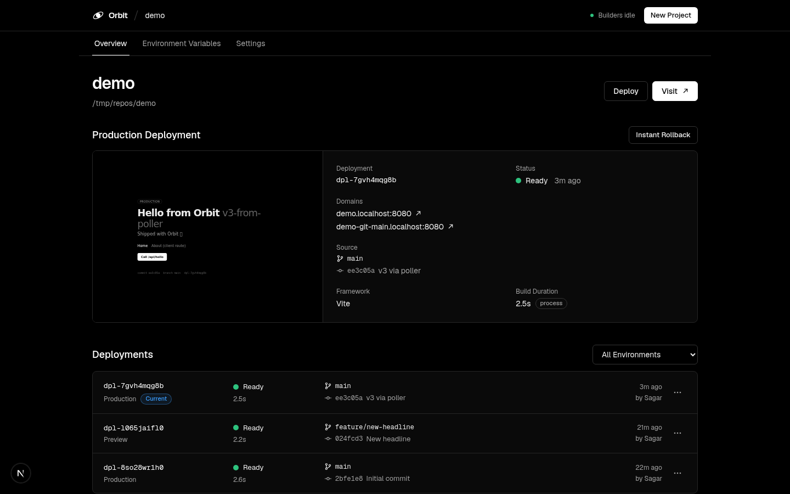
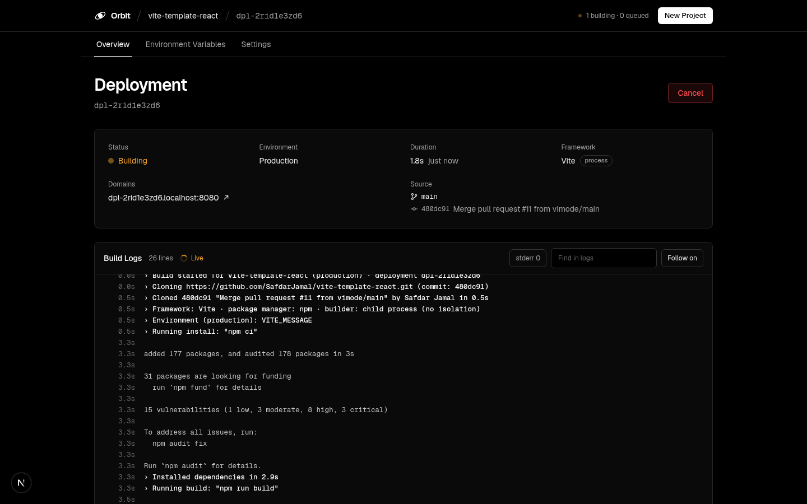
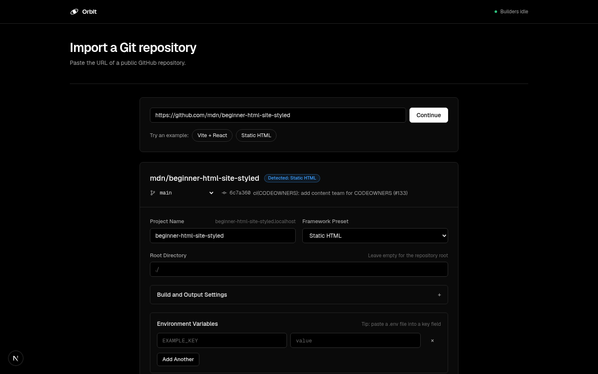
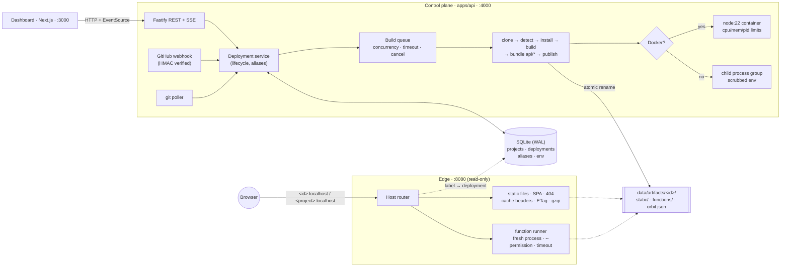

# Orbit

**An open-source, self-hostable deployment platform in the spirit of Vercel.** Connect a GitHub repository and
every push is built and served: production on your domain, a preview URL for every branch and pull request,
serverless functions from `api/`, and instant rollbacks. One server, one command.

```bash
curl -fsSL https://raw.githubusercontent.com/sagarvarma1/orbit/main/install.sh | sudo bash
```

Nothing is simulated: every deployment is a real `git fetch`, a real `npm ci`/`pnpm install`, a real framework
build in an isolated container, and real files served by a Host-routing edge with automatic HTTPS.



| Live build logs (SSE)                        | Import flow with framework detection   |
| -------------------------------------------- | -------------------------------------- |
|  |  |

> Orbit is an independent project. It is not affiliated with, or endorsed by, Vercel Inc. It reads `vercel.json`
> routing rules so existing projects work without changes.

## Features

**Git workflow**

- **GitHub App, created in one click** from Settings using GitHub's manifest flow. Deploy **private repositories**,
  pick repos from a list, and get pushes instantly through the app's webhook (no tokens to paste).
- **Preview deployments** for every branch, and a production deployment for the production branch.
- **Commit statuses and pull request comments**: pending → ready/failed on each commit, and one PR comment with the
  preview link that's updated in place as the build progresses.
- **Promote and instant rollback**: production is a pointer, so switching it is a single-row update with no rebuild.
  Like Vercel, a rollback pauses auto-promotion until you promote again.

**Builds**

- **Framework detection** for Next.js, Vite, Create React App, Astro, any `build` script, or plain static HTML,
  with overridable install/build commands and output directory. `vercel.json` build settings are honored.
- **Next.js with server rendering**: apps without `output: 'export'` are built as a standalone server (no config
  changes needed). Each deployment gets its own server, started on the first request, kept warm and stopped when
  idle, sandboxed like functions. The edge serves `/_next/static` and `public/` from disk and streams everything else
  from the server, so SSR, route handlers and server actions work, and rollbacks still switch instantly.
- **Monorepos**: set a root directory (`apps/web`) and Orbit installs from the workspace root (npm, pnpm or yarn
  workspaces) and builds the app. Turborepo is detected and used to build internal dependencies first.
- **Isolated builds**: each step runs in a throwaway `node:22` container with CPU, memory and PID limits. On a
  public server Orbit refuses to build without Docker.
- **Build cache**: `node_modules` is kept per project, keyed by the lockfile; on a hit, install is skipped. Entries
  are moved with `rename`, so restore and save are O(1). "Redeploy without Cache" forces a clean install.
- **Build queue** with concurrency, timeouts and cancel (the whole process tree is killed).
- **Live logs over SSE**, persisted and replayed on reconnect with `Last-Event-ID`.
- **Environment variables** per target (production / preview), plus `ORBIT_*` system variables.

**Serving**

- **Custom domains with automatic HTTPS**: add a domain to a project, point DNS at the server, and Caddy issues a
  certificate on the first request. Orbit only approves certificates for hostnames it actually serves.
- **Immutable deployments** at `<deployment-id>.<your-domain>`, plus `<project>.<your-domain>` for production and
  `<project>-git-<branch>.<your-domain>` for the latest build of each branch.
- **Serverless functions**: `api/**/*.{js,ts}` bundled with esbuild and served at `/api/*`, with `[param]` segments.
  Each invocation runs in a fresh Node process under the permission model (no fs writes, no child processes), with a
  memory cap and a timeout. Web-standard (`Request → Response`) or Node-style `(req, res)` handlers.
- **`vercel.json` routing**: `redirects`, `rewrites` and `headers` with Vercel's path syntax, validated at build time.
- **Edge router**: clean URLs, SPA fallback for navigations, correct content types, `immutable` caching for
  fingerprinted assets, ETags and 304s, gzip, path-traversal protection and the site's own `404.html`.

**Platform**

- **Sign in with GitHub**, through the instance's own GitHub App. With `ORBIT_SIGNUPS=open` anyone can create an
  account: each account sees only its own projects, and can import only repositories it can push to (or public ones
  nobody installed Orbit on), so nobody can deploy someone else's private repo with the app's access. Members have
  project and concurrent-build limits; the admin (the GitHub App's owner) has none and manages the app.
- **First-run setup** with a one-time code from the server logs, so nobody can claim a fresh instance before you do.
  Sessions are `HttpOnly` cookies; writes are checked against the dashboard's origin (deployments share the parent
  domain, so `SameSite` alone isn't enough).
- **API tokens** for scripts and CI (`Authorization: Bearer orbit_…`). Only hashes are stored.
- **Dashboard** (Next.js 16, TypeScript, Tailwind v4): projects, import with repo picker, deployments, logs, env vars,
  domains, settings.

## Architecture



The core idea is the same as a real platform. **Builds produce immutable artifacts, and aliases are the only
mutable pointer.** The edge never builds or writes. It resolves `hostname → deployment` and serves files, so it
keeps serving even while the control plane is busy or down. Promote and rollback just move a pointer.

| Path                                   | What lives there                                                                                              |
| -------------------------------------- | ------------------------------------------------------------------------------------------------------------- |
| `apps/api/src/index.ts`                | Control plane entry (API, queue, poller)                                                                      |
| `apps/api/src/edge.ts`                 | Edge entry (Host router)                                                                                      |
| `apps/api/src/build/`                  | `detect` (framework/PM), `git`, `pipeline`, `queue`, `runner` (Docker/process), `logs`, `functions` (esbuild) |
| `apps/api/src/edge/`                   | `server` (routing), `static` (file resolution, cache headers), `functions` (isolated invocation), `pages`     |
| `apps/api/src/services/`               | `deployments` (lifecycle, promote/rollback), `git-sync` (webhook + poller), `auth`, `github-app`, `github`    |
| `apps/api/src/routes/`                 | REST routes: projects, deployments, domains, auth and tokens, GitHub App, webhooks                            |
| `apps/api/src/db/`                     | SQLite schema and typed repository (all SQL in one place)                                                     |
| `apps/api/runtime/function-runner.mjs` | The sandboxed per-invocation function process                                                                 |
| `apps/dashboard/`                      | Next.js dashboard                                                                                             |
| `examples/orbit-demo-app/`             | Vite + React demo: a draggable badge, `api/hello.js` and `vercel.json` rules                                  |
| `deploy/`, `install.sh`                | Production compose file, Caddy config (on-demand HTTPS) and the one-line installer                            |
| `scripts/e2e.mjs`                      | End-to-end test against real repos                                                                            |

See [PLAN.md](PLAN.md) for the design and tradeoffs.

## Self-hosting

On a fresh Linux server (2+ vCPU, 4 GB RAM) with ports 80 and 443 open:

```bash
curl -fsSL https://raw.githubusercontent.com/sagarvarma1/orbit/main/install.sh | sudo bash
```

The installer asks for a domain (say `example.com`), installs Docker if needed, writes `/opt/orbit`
(`docker-compose.yml`, `Caddyfile`, `.env`), starts Orbit and prints:

1. **DNS**: one wildcard `A` record, `*.example.com`, pointing at the server. The dashboard lives at `app.example.com`.
2. **Setup**: open `https://app.example.com/setup` and enter the setup code it printed to create the admin account.
3. **GitHub**: Settings → Create GitHub App → install it on your repositories.

Details, upgrades, backups and the wildcard-certificate option are in [docs/self-hosting.md](docs/self-hosting.md).

## Local development

Requirements: **Node 22.13+**, **pnpm** (`corepack enable`), **git**. Docker is optional on a laptop.

```bash
pnpm install
cp .env.example .env
pnpm dev
```

- Dashboard: http://localhost:3000. On first start the API prints a **setup code**; open `/setup` and enter it
  (or set `ORBIT_ADMIN_EMAIL` and `ORBIT_ADMIN_PASSWORD` in `.env` to create the admin automatically).
- API: http://localhost:4000
- Deployments: `http://<deployment-id>.localhost:8080` and `http://<project>.localhost:8080` (browsers resolve
  `*.localhost` without DNS)

GitHub can't reach `localhost`, so push-to-deploy uses the `git ls-remote` poller (`GIT_POLL_INTERVAL_SECONDS`).
The GitHub App flow works locally too; its webhook is simply left inactive.

## Configuration

| Variable                                                   | Default                 | Description                                                                           |
| ---------------------------------------------------------- | ----------------------- | ------------------------------------------------------------------------------------- |
| `ORBIT_ROOT_DOMAIN`                                        | `localhost`             | Deployments are served at `<label>.<root>`                                            |
| `ORBIT_DASHBOARD_URL`                                      | `http://localhost:3000` | Where the dashboard lives (CORS, cookies, GitHub App redirects, "Inspect" links)      |
| `ORBIT_PUBLIC_PROTOCOL` / `ORBIT_PUBLIC_EDGE_PORT`         | `http` / `8080`         | How URLs are rendered (`https` / `443` behind Caddy)                                  |
| `ORBIT_PUBLIC_IP`                                          | (resolved)              | Server IP shown in DNS instructions for apex domains                                  |
| `ORBIT_ADMIN_EMAIL` / `ORBIT_ADMIN_PASSWORD`               | (empty)                 | Create the admin on first boot instead of using a setup code                          |
| `ORBIT_RESET_ADMIN_PASSWORD`                               | (empty)                 | Set a new admin password on boot (remove it afterwards)                               |
| `ORBIT_SIGNUPS`                                            | `closed`                | `open` lets anyone sign up with GitHub (each account sees only its own projects)      |
| `ORBIT_ADMIN_GITHUB`                                       | (app owner)             | GitHub login of the admin; it takes over the setup account on first GitHub sign-in    |
| `MAX_PROJECTS_PER_USER` / `MAX_ACTIVE_BUILDS_PER_USER`     | `10` / `2`              | Limits for non-admin accounts                                                         |
| `ORBIT_API_PUBLIC_URL`                                     | dashboard origin        | Where GitHub sends sign-ins back to (only when the API isn't on the dashboard origin) |
| `TRUST_PROXY`                                              | `0`                     | Trust `X-Forwarded-*` from a reverse proxy                                            |
| `ORBIT_BUILDER`                                            | `auto`                  | `auto`, `docker` or `process`                                                         |
| `ORBIT_BUILD_IMAGE`                                        | `node:22-bookworm-slim` | Image for Docker builds                                                               |
| `BUILD_CONCURRENCY` / `BUILD_TIMEOUT_SECONDS`              | `2` / `600`             | Queue limits                                                                          |
| `BUILD_MEMORY` / `BUILD_CPUS`                              | `2g` / `2`              | Docker build limits                                                                   |
| `BUILD_CACHE`                                              | `1`                     | `0` disables the build cache                                                          |
| `FUNCTION_TIMEOUT_MS` / `FUNCTION_MEMORY_MB`               | `10000` / `128`         | Function limits                                                                       |
| `FUNCTION_MAX_MEMORY_MB` / `FUNCTION_MAX_DURATION_SECONDS` | `1024` / `60`           | Upper bounds for per-function `memory` / `maxDuration` in vercel.json                 |
| `FUNCTION_CACHE_MB`                                        | `64`                    | Edge cache for function responses with `s-maxage` (`0` = off)                         |
| `FUNCTION_WARM_PER_FUNCTION` / `FUNCTION_WARM_MAX`         | `1` / `4`               | Idle function processes kept warm per function / in total (`0` = cold every request)  |
| `FUNCTION_IDLE_TIMEOUT_SECONDS`                            | `300`                   | Stop a warm function process after this long without requests                         |
| `SERVER_MAX` / `SERVER_MEMORY_MB`                          | `3` / `512`             | Next.js servers running at once / heap per server                                     |
| `SERVER_IDLE_TIMEOUT_SECONDS`                              | `600`                   | Stop a deployment's Next.js server after this long without requests                   |
| `GIT_POLL_INTERVAL_SECONDS`                                | `0`                     | Poll branch heads (0 = off)                                                           |
| `GITHUB_WEBHOOK_SECRET`                                    | (empty)                 | For a manually added repository webhook (the GitHub App has its own secret)           |
| `GITHUB_TOKEN`                                             | (empty)                 | Personal access token fallback for commit statuses and PR comments                    |
| `GITHUB_API_URL` / `GITHUB_WEB_URL`                        | GitHub.com              | GitHub Enterprise, or fakes in tests                                                  |
| `ORBIT_DATA_DIR` / `ORBIT_HOST_DATA_DIR`                   | `./data`                | SQLite DB, artifacts, logs, builds; host path when running in a container             |
| `API_PORT` / `EDGE_PORT`                                   | `4000` / `8080`         | Listen ports                                                                          |
| `NEXT_PUBLIC_API_URL`                                      | `http://localhost:4000` | API URL baked into the dashboard; empty = same origin (production images)             |

## Testing

```bash
pnpm test        # unit tests: auth, domains, GitHub App, detection (incl. monorepos), edge, routing, cache, queue, webhooks
pnpm e2e         # boots a real control plane + edge and deploys real repos end to end
pnpm e2e --next  # also builds Next.js apps: a static export, and server rendering with redeploy and rollback
./scripts/sandbox-test.sh --e2e  # sandbox tests + full e2e as root in a Linux container (needs Docker)
```

The e2e suite (68 checks, 87 with `--next`) signs in, issues an API token, and deploys `mdn/beginner-html-site-styled` and a Vite app
from GitHub plus local fixtures, including an npm-workspaces monorepo. It verifies preview and production URLs,
cache headers, SPA fallback, live SSE logs, env injection, functions, signed webhooks, promote and rollback,
immutability, redeploys, failing builds, cancelling a build (and that the process tree is gone), `vercel.json`
rules, the build cache, and commit statuses and PR comments against a fake GitHub API.

## API

Every route except health, sign-in and webhooks needs a session or `Authorization: Bearer <api token>`.

```
GET    /api/auth/github?next=                 (redirects to GitHub; returns to /api/auth/github/callback)
POST   /api/auth/setup | login | logout       GET /api/auth/status      POST /api/auth/password
GET    /api/tokens                            POST /api/tokens  {name}  DELETE /api/tokens/:id
GET    /api/projects                          POST /api/projects        (import + first deploy)
GET    /api/projects/:name                    PATCH /api/projects/:name  DELETE /api/projects/:name
GET    /api/projects/:name/deployments        POST /api/projects/:name/deployments  {branch}
POST   /api/projects/:name/rollback           {deploymentId?}
GET    /api/projects/:name/env                PUT/DELETE /api/projects/:name/env/:key
GET    /api/projects/:name/domains            POST {hostname, branch?}  DELETE /api/projects/:name/domains/:hostname
GET    /api/deployments/:id                   GET /api/deployments/:id/logs   GET .../logs/stream (SSE)
POST   /api/deployments/:id/{promote,redeploy,cancel}
POST   /api/inspect                           {repoUrl, branch?, rootDirectory?}
GET    /api/github                            POST /api/github/manifest  GET /api/github/repositories
POST   /api/webhooks/github                   (X-Hub-Signature-256 verified)
GET    /api/tls/allowed?domain=               (Caddy on-demand TLS check)
```

## Security

- Builds run untrusted code. On a public server they run in Docker containers with resource limits and no access
  to Orbit's secrets; the child-process builder is for local development only.
- Deployment code (functions and Next.js servers) is isolated in three layers:
  1. **Its own Linux user per project.** Artifacts belong to that user's group (read-only), the env file the edge
     passes in is root-only, and the database, build logs, caches and other projects' files are unreadable. Each
     server's writable cache directory belongs to its user alone.
  2. **A firewall** (iptables, in the edge container's network namespace) stops those users from connecting to
     private addresses: Orbit's API, the Docker network, localhost services and the cloud metadata endpoint. The
     public internet stays reachable.
  3. **Node's permission model** on top: reads limited to the deployment's own files, no file writes outside its
     cache, no child processes, workers or native addons. Code also runs at lower CPU priority than the edge.

  Layers 1 and 2 need Linux and root, which is how the edge runs in its container (the firewall needs `NET_ADMIN`,
  set in `deploy/docker-compose.yml`); the edge logs which layers are on at startup. CI runs the sandbox tests and the
  full e2e suite as root to check them. Processes still share one kernel, unlike Vercel's microVMs.

- Accounts only see their own projects (others' return 404), and members can only import repositories they can push
  to, so the GitHub App's installation access can't be borrowed to read someone else's private code.
- The dashboard and API share one origin in production. Deployments live on sibling subdomains, so state-changing
  requests made with the session cookie must come from the dashboard's origin. For stronger isolation, serve
  deployments from a separate domain (e.g. dashboard at `orbit.example.com`, deployments at `*.example.app`).
- GitHub App credentials and env vars are stored in SQLite on the server. Back up and protect `ORBIT_DATA_DIR`.

Please report vulnerabilities privately; see [SECURITY.md](SECURITY.md).

## Limitations

- Next.js server rendering works per deployment, but ISR revalidation, middleware at the edge and `next/image`
  optimization (needs `sharp`) aren't wired up yet. Other SSR frameworks (Remix, SvelteKit, Nuxt) aren't detected.
- One server. Accounts are individual: no shared team projects yet, and custom domains are first come, first served
  (no TXT ownership check).
- `vercel.json` covers `redirects`, `rewrites` (internal paths only) and `headers`, without `has`/`missing`.
- The build cache is skipped for monorepos and custom install commands, where skipping install isn't safe.
- Deployment code is isolated with per-project users, a firewall and Node's permission model, not VMs or containers
  per deployment. A first request after idle is a cold start.
- Each deployment hostname gets its own certificate on first visit. Let's Encrypt allows 50 certificates per domain
  per week; heavy preview use should switch to a wildcard certificate ([docs/self-hosting.md](docs/self-hosting.md)).

## Roadmap

- ISR, middleware and image optimization for Next.js; more SSR frameworks
- Runtime logs and basic analytics
- Teams (shared projects), domain ownership verification
- Per-deployment containers (or gVisor) for functions and app servers
- `orbit` CLI (`orbit deploy` from any folder)

## Contributing

Issues and pull requests are welcome. See [CONTRIBUTING.md](CONTRIBUTING.md).

## License

[MIT](LICENSE)
