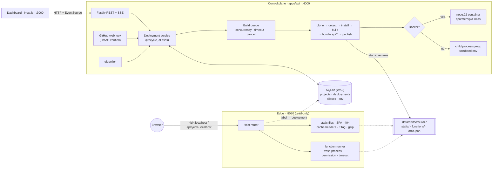

# Orbit

**A small, self-hostable deployment platform: a mini Vercel.** Point Orbit at a public GitHub
repository and it really clones, installs, builds and serves it at an immutable preview URL.
You get a production domain you can promote to and roll back instantly, live build logs,
push-to-deploy previews for every branch, and serverless functions from `api/`.

Nothing is simulated: every deployment is a real `git fetch`, a real `npm ci`/`pnpm install`, a
real framework build, and real files served by a Host-routing edge.


| Live build logs (SSE)                        | Import flow with framework detection   |
| -------------------------------------------- | -------------------------------------- |
|  |  |

## Features

- **Import from GitHub**: paste a URL, pick a branch, and Orbit auto-detects **Next.js (static export), Vite,
  Create React App, Astro, any `build` script, or plain static HTML**. You can override the install
  command, build command, output directory and root directory (for monorepos).
- **Build pipeline**: shallow single-ref fetch, package manager picked from the lockfile (npm, pnpm or yarn),
  and project env vars injected per target (production or preview) plus `ORBIT_*` system variables.
- **Isolated builds**: each step runs in a throwaway `node:22` container (CPU, memory and PID limits) when Docker
  is available, and falls back to a detached child-process group with a scrubbed environment otherwise.
- **Build queue** with a concurrency limit, per-build timeout and cancel. Cancel kills the whole process tree.
- **Build cache**: `node_modules` is kept per project, keyed by a hash of the lockfile, `package.json`, install
  command and platform. On a hit, install is skipped entirely. `.next/cache` is carried over too. Entries are
  _moved_ in and out of the build workspace with `rename`, so restore and save are O(1) at any size, and a failed
  build hands the cache back untouched. "Redeploy without Cache" forces a clean install.
- **Live logs over SSE**, persisted as NDJSON, replayed on reconnect with `Last-Event-ID`.
- **Immutable deployments**: each build is published once, atomically, to its own artifact directory and
  served at `http://<deployment-id>.localhost:8080`. No DNS is needed, because browsers resolve `*.localhost`.
- **Production alias and branch aliases**: `http://<project>.localhost:8080` points at the current
  production deployment, and `http://<project>-git-<branch>.localhost:8080` follows the latest build of a branch.
- **Promote and instant rollback**: a single-row alias update in a transaction. There's no rebuild, and it takes
  milliseconds. Like Vercel, a rollback pauses auto-promotion until you promote again.
- **`vercel.json` routing**: `redirects`, `rewrites` and `headers` with Vercel's path syntax (`/blog/:slug`,
  `/docs/:path*`, `/(.*)`, `$1`). Rules are validated at build time (a typo fails the build, not a request), stored
  in the immutable manifest and applied by the edge: redirects first, then functions, files on disk, rewrites
  (to files or functions), and finally SPA fallback / 404.
- **GitHub commit statuses and PR comments**: with `GITHUB_TOKEN` set, each deployment sets a commit status
  (pending → success/failure, linking to the preview or the logs) and posts one comment per open pull request with
  the preview URL, edited in place as the build progresses. Opening a PR for an already-deployed branch
  (webhook `pull_request` event) posts the comment straight away.
- **Edge router**: Host-header routing, clean URLs, SPA fallback only for navigations (missing assets stay 404),
  correct content types, `immutable` caching for fingerprinted assets, strong ETags and 304s, gzip,
  path-traversal protection, the site's own `404.html`, and status pages for building or failed deployments.
- **Push-to-deploy**: a GitHub webhook endpoint with HMAC-SHA256 signature verification. Pushes to the production
  branch go to production, and every other branch becomes a preview. Redeliveries are deduplicated. For laptops,
  where GitHub can't reach you, an optional `git ls-remote` poller feeds the same code path.
- **Serverless functions**: `api/**/*.{js,ts}` are bundled with esbuild and served at `/api/*`, with dynamic
  `[param]` segments. Each invocation runs in a fresh Node process under the **permission model**
  (read-only access to its own bundle, no child processes, no fs writes), with a memory cap and a 10s timeout.
  Handlers can be Web-standard (`Request → Response`, or `GET`/`POST` exports) or Node-style `(req, res)`.
- **Dashboard** (Next.js 16 App Router, TypeScript, Tailwind v4): projects, import flow, deployments list,
  deployment detail with log viewer, env var editor, promote, rollback, redeploy and cancel, plus a live
  thumbnail of production.

## Architecture



The core idea is the same as a real platform. **Builds produce immutable artifacts, and aliases are the only
mutable pointer.** The edge never builds or writes. It resolves `hostname → deployment` and serves files, so it
keeps serving even while the control plane is busy or down. Promote and rollback just move a pointer.

| Path                                   | What lives there                                                                                              |
| -------------------------------------- | ------------------------------------------------------------------------------------------------------------- |
| `apps/api/src/index.ts`                | Control plane entry (API, queue, poller)                                                                      |
| `apps/api/src/edge.ts`                 | Edge entry (Host router)                                                                                      |
| `apps/api/src/build/`                  | `detect` (framework/PM), `git`, `pipeline`, `queue`, `runner` (Docker/process), `logs`, `functions` (esbuild) |
| `apps/api/src/edge/`                   | `server` (routing), `static` (file resolution, cache headers), `functions` (isolated invocation), `pages`     |
| `apps/api/src/services/`               | `deployments` (lifecycle, promote/rollback), `git-sync` (webhook + poller)                                    |
| `apps/api/src/db/`                     | SQLite schema and typed repository (all SQL in one place)                                                     |
| `apps/api/runtime/function-runner.mjs` | The sandboxed per-invocation function process                                                                 |
| `apps/dashboard/`                      | Next.js dashboard                                                                                             |
| `examples/orbit-demo-app/`             | Vite + React app with an env var, a client route and `api/hello.js`, for demos                                |
| `scripts/e2e.mjs`                      | End-to-end test against real repos                                                                            |

See [PLAN.md](PLAN.md) for the design, tradeoffs and what's out of scope.

## Quick start

Requirements: **Node 22.13+**, **pnpm** (`corepack enable`), **git**. Docker is optional.

```bash
pnpm install
cp .env.example .env          # optional: webhook secret, git polling, builder mode
pnpm dev
```

- Dashboard: http://localhost:3000
- API: http://localhost:4000
- Deployments: `http://<deployment-id>.localhost:8080` and `http://<project>.localhost:8080`

Then click **New Project**, choose an example repo, and press **Deploy**.

### With Docker (one command)

```bash
docker compose up --build
```

Same ports. The control plane mounts the Docker socket and runs every build in its own sibling container, so
`./data` must stay a bind mount (see the comment in `docker-compose.yml`).

### Try push-to-deploy locally

GitHub can't reach `localhost`, so either:

- set `GIT_POLL_INTERVAL_SECONDS=5` in `.env` (Orbit polls `git ls-remote` and deploys new commits), or
- expose the webhook with a tunnel (`npx smee-client --url https://smee.io/<id> --target http://localhost:4000/api/webhooks/github`)
  and add a GitHub webhook (content type `application/json`, secret = `GITHUB_WEBHOOK_SECRET`, push events).

## Configuration

| Variable                                           | Default                  | Description                                                                           |
| -------------------------------------------------- | ------------------------ | ------------------------------------------------------------------------------------- |
| `ORBIT_DATA_DIR`                                   | `./data`                 | SQLite DB, artifacts, logs, build workspaces                                          |
| `API_PORT` / `EDGE_PORT`                           | `4000` / `8080`          | Listen ports                                                                          |
| `ORBIT_ROOT_DOMAIN`                                | `localhost`              | Deployments are served at `<label>.<root>`                                            |
| `ORBIT_PUBLIC_PROTOCOL` / `ORBIT_PUBLIC_EDGE_PORT` | `http` / `8080`          | How URLs are rendered (use `https` / `443` behind Caddy)                              |
| `ORBIT_BUILDER`                                    | `auto`                   | `auto`, `docker` or `process`                                                         |
| `ORBIT_BUILD_IMAGE`                                | `node:22-bookworm-slim`  | Image for Docker builds                                                               |
| `BUILD_CONCURRENCY` / `BUILD_TIMEOUT_SECONDS`      | `2` / `600`              | Queue limits                                                                          |
| `BUILD_MEMORY` / `BUILD_CPUS`                      | `2g` / `2`               | Docker build limits                                                                   |
| `FUNCTION_TIMEOUT_MS` / `FUNCTION_MEMORY_MB`       | `10000` / `128`          | Function limits                                                                       |
| `GITHUB_WEBHOOK_SECRET`                            | (empty)                  | Enables `POST /api/webhooks/github`                                                   |
| `GITHUB_TOKEN`                                     | (empty)                  | Enables commit statuses and PR comments (needs Commit statuses + Pull requests write) |
| `GITHUB_API_URL`                                   | `https://api.github.com` | GitHub API base (GitHub Enterprise, or a fake server in tests)                        |
| `ORBIT_DASHBOARD_URL`                              | `http://localhost:3000`  | Used for "Inspect" links posted to GitHub                                             |
| `BUILD_CACHE`                                      | `1`                      | `0` disables the build cache                                                          |
| `GIT_POLL_INTERVAL_SECONDS`                        | `0`                      | Poll branch heads (0 = off)                                                           |
| `ORBIT_HOST_DATA_DIR`                              | `ORBIT_DATA_DIR`         | Host path of the data dir when the control plane runs in a container                  |
| `NEXT_PUBLIC_API_URL`                              | `http://localhost:4000`  | Control plane URL used by the dashboard (build time)                                  |

## Testing

```bash
pnpm test        # unit tests: detection, router/edge, routing rules, build cache, GitHub notifier, functions, queue, webhooks, poller
pnpm e2e         # boots a real control plane + edge and deploys real repos end to end
pnpm e2e --next  # also builds a Next.js static-export app
```

The e2e suite runs 61 checks (64 with `--next`). It deploys `mdn/beginner-html-site-styled` and `SafdarJamal/vite-template-react` from
GitHub plus local fixture repos. It verifies preview and production URLs over HTTP with Host headers, cache headers,
SPA fallback, live SSE delivery, persisted logs, build-time env injection, production-only env, functions, a signed
webhook push creating a pinned preview, idempotent redelivery, promote, rollback (timed), immutability after an env
change, redeploy, a failing build with stderr captured, and cancelling a running build (including checking that the
process tree is gone). It also covers `vercel.json` redirects, rewrites and headers, a build-cache miss then hit (install
skipped) and a no-cache redeploy, and commit statuses and PR comments against a fake GitHub API.

## Deploying to a VPS

See [docs/DEPLOY_VPS.md](docs/DEPLOY_VPS.md) for public URLs like `https://my-app.yourdomain.com` using Caddy with a
wildcard certificate (DNS challenge).

## API sketch

```
GET    /api/projects                         POST /api/projects            (import + first deploy)
GET    /api/projects/:name                   PATCH /api/projects/:name     DELETE /api/projects/:name
GET    /api/projects/:name/deployments       POST /api/projects/:name/deployments   {branch}
POST   /api/projects/:name/rollback          {deploymentId?}
GET    /api/projects/:name/env               PUT/DELETE /api/projects/:name/env/:key
GET    /api/deployments/:id                  GET /api/deployments/:id/logs
GET    /api/deployments/:id/logs/stream      (Server-Sent Events)
POST   /api/deployments/:id/{promote,redeploy,cancel}   (redeploy takes {useCache?})
POST   /api/inspect                          {repoUrl, branch?}  (detect before import)
POST   /api/webhooks/github                  (X-Hub-Signature-256 verified; push + pull_request)
```

## Limitations (honest list)

- Static output and functions only. Next.js needs `output: 'export'`. No SSR, ISR, middleware or image optimization.
- `vercel.json` support covers `redirects`, `rewrites` (internal paths only) and `headers`, without `has`/`missing`
  conditions. Other keys are ignored.
- Single node, single tenant, no auth. The VPS guide puts the dashboard behind basic auth.
- Public repositories only. GitHub statuses and comments use a personal access token, not a GitHub App.
- The build cache is skipped for workspaces/monorepos and custom install commands, where skipping install isn't safe.
- Function cold start on every invocation (~50–100 ms). A real platform keeps warm sandboxes.
- The child-process builder is **not** a security boundary. Use Docker mode for untrusted code.
